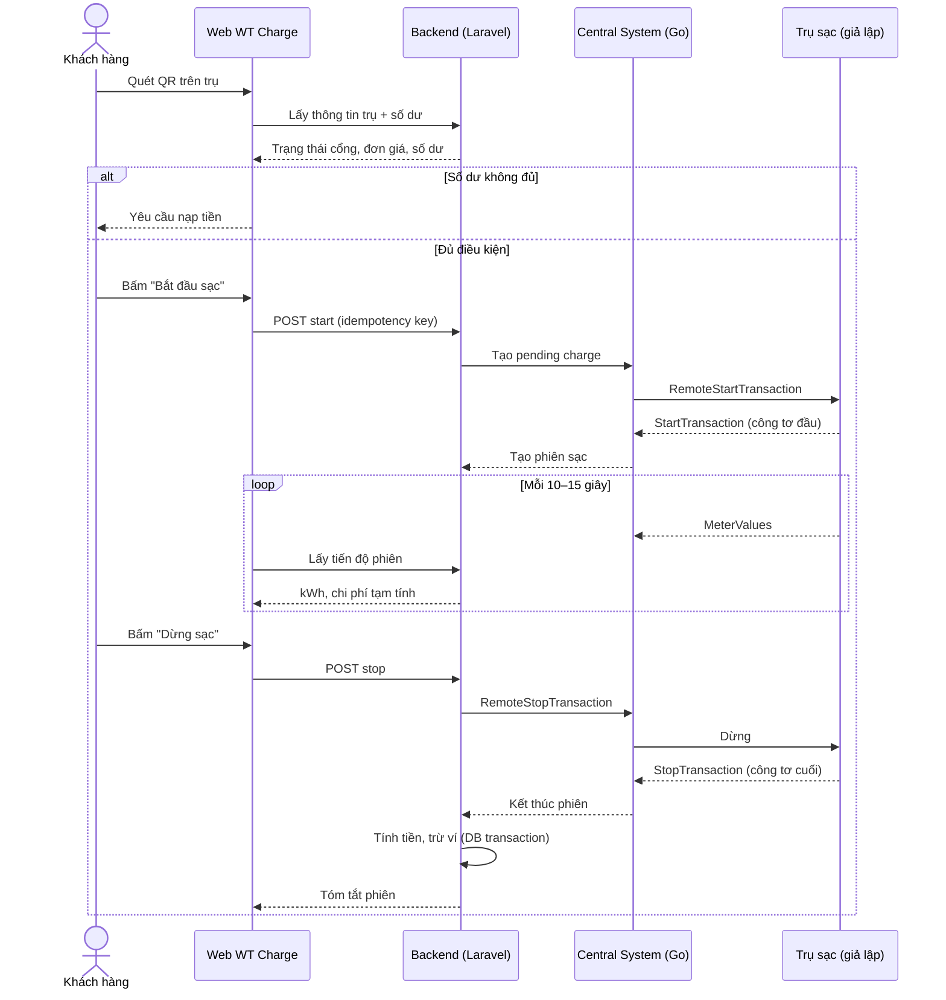
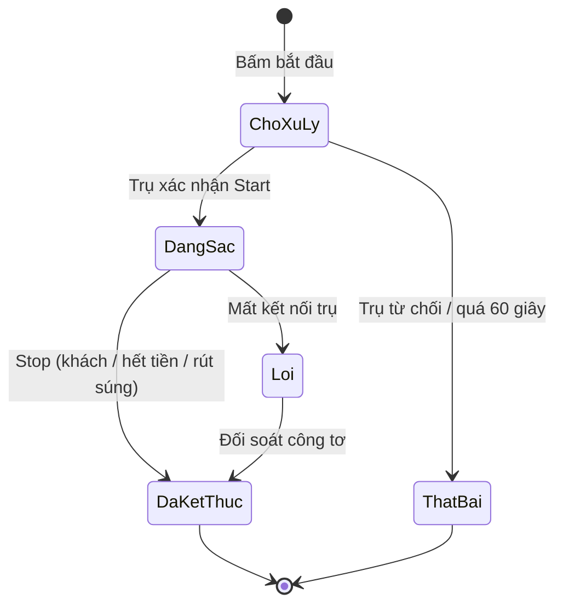

# Quy trình nghiệp vụ

Tài liệu mô tả 3 quy trình chính. Quy trình 1 (sạc xe) là quy trình cốt lõi của đề tài.

## Quy trình 1 – Sạc xe bằng mã QR (quy trình chính)

### Các bước

1. Khách hàng đến trạm, dùng camera điện thoại quét **mã QR dán trên trụ** (mã QR = mã trụ + số cổng).
2. Trình duyệt mở trang web WT Charge của trụ đó. Nếu chưa đăng nhập → chuyển tới trang đăng nhập, đăng nhập xong quay lại đúng trụ.
3. Hệ thống hiển thị: tên trạm, trạng thái cổng, **đơn giá/kWh**, số dư ví của khách.
4. Hệ thống kiểm tra điều kiện:
   - Cổng ở trạng thái *Sẵn sàng*, trụ không bị khóa.
   - Khách không có phiên sạc nào khác đang chạy.
   - Số dư ≥ mức tối thiểu. Nếu không đủ → hiện nút **Nạp tiền** (sang Quy trình 2).
5. Khách cắm súng sạc vào xe và bấm **Bắt đầu sạc**.
6. Backend tạo bản ghi *chờ sạc* (`pending_charges`, có idempotency key) → Central System gửi lệnh `RemoteStartTransaction` tới trụ.
7. Trụ phản hồi `StartTransaction` kèm chỉ số công tơ ban đầu → hệ thống tạo phiên sạc (`transactions`), lưu **đơn giá tại thời điểm bắt đầu**.
8. Trong khi sạc, trụ gửi `MeterValues` định kỳ → trang web hiển thị kWh, thời gian và chi phí tạm tính.
9. Phiên kết thúc khi xảy ra **một trong ba** trường hợp:
   - Khách bấm **Dừng sạc** → lệnh `RemoteStopTransaction`;
   - Chi phí tạm tính chạm số dư ví → hệ thống tự dừng;
   - Khách rút súng sạc / trụ tự dừng.
10. Trụ gửi `StopTransaction` kèm chỉ số công tơ cuối → backend tính **tiền = (công tơ cuối − công tơ đầu) × đơn giá** và trừ ví trong một database transaction.
11. Khách xem tóm tắt phiên (kWh, thời gian, số tiền, số dư còn lại); phiên được lưu vào lịch sử.

### Sơ đồ

### Trạng thái phiên sạc

### Ngoại lệ cần xử lý

| Tình huống | Cách xử lý |
|---|---|
| Bấm "Bắt đầu" 2 lần | Idempotency key → chỉ tạo 1 phiên |
| Trụ không phản hồi lệnh Start sau 60 giây | Đánh dấu *Thất bại*, không trừ tiền, báo khách thử lại |
| Mất mạng phía khách trong khi sạc | Phiên vẫn chạy trên trụ; khách mở lại web sẽ thấy phiên đang chạy |
| Trụ mất kết nối giữa phiên | Đánh dấu *Lỗi*; khi trụ kết nối lại thì đối soát chỉ số công tơ; QTV xem được danh sách phiên lỗi |
| Chi phí vượt số dư | Tự dừng khi chạm số dư; nếu vẫn vượt do độ trễ thì trừ tối đa bằng số dư, **không để ví âm**, ghi chú để QTV xử lý |

## Quy trình 2 – Nạp tiền vào ví

1. Khách vào mục **Ví** → chọn mệnh giá nhanh hoặc nhập số tiền (≥ 5.000 đ).
2. Backend tạo giao dịch nạp ở trạng thái *Chờ thanh toán*, sinh mã giao dịch duy nhất, tạo URL thanh toán VNPay có chữ ký.
3. Khách được chuyển sang trang VNPay sandbox, thanh toán bằng thẻ test.
4. VNPay gọi **IPN** về backend → backend kiểm tra chữ ký, số tiền, mã giao dịch:
   - Hợp lệ và chưa xử lý → cộng ví, chuyển giao dịch sang *Thành công*.
   - Đã xử lý trước đó → bỏ qua (không cộng lần hai).
   - Sai chữ ký / sai số tiền → *Thất bại*, ghi log.
5. VNPay chuyển khách về trang kết quả trên web → hiển thị trạng thái và số dư mới.

> Lưu ý: trang kết quả (return URL) **chỉ để hiển thị**. Ví chỉ được cộng qua IPN.

## Quy trình 3 – Quản trị viên thêm trụ sạc mới

1. QTV đăng nhập trang quản trị → **Trụ sạc** → **Thêm mới**.
2. Nhập mã trụ (trùng với mã client mà trụ dùng khi kết nối Central System), tên trạm, địa chỉ, số cổng, đơn giá/kWh.
3. Hệ thống kiểm tra mã trụ không trùng → lưu.
4. QTV bấm **In mã QR** → hệ thống sinh QR cho từng cổng để dán lên trụ.
5. Khi trụ kết nối (`BootNotification`), trạng thái chuyển sang *Online* trên dashboard.
